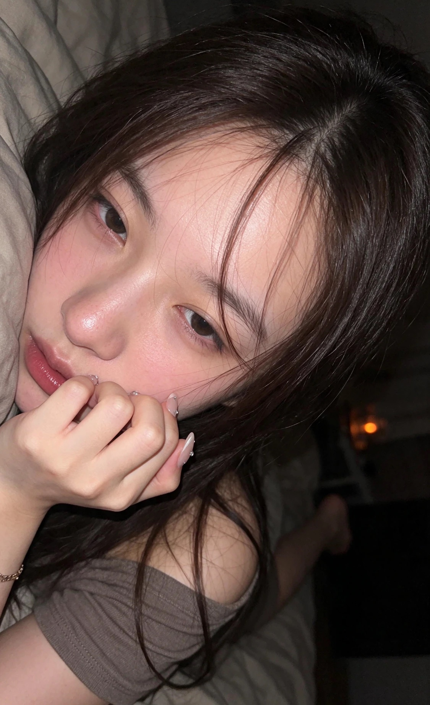
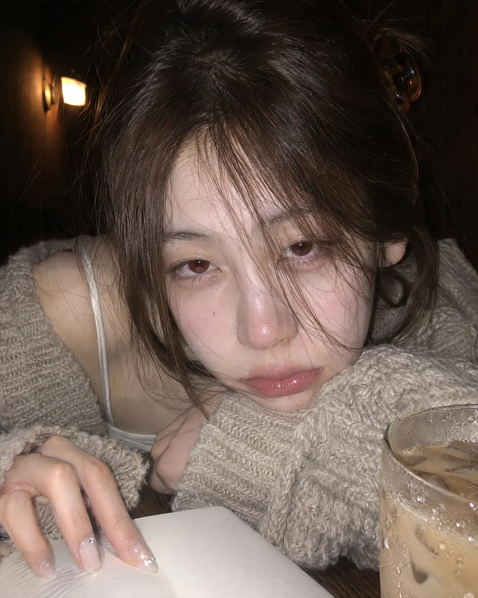
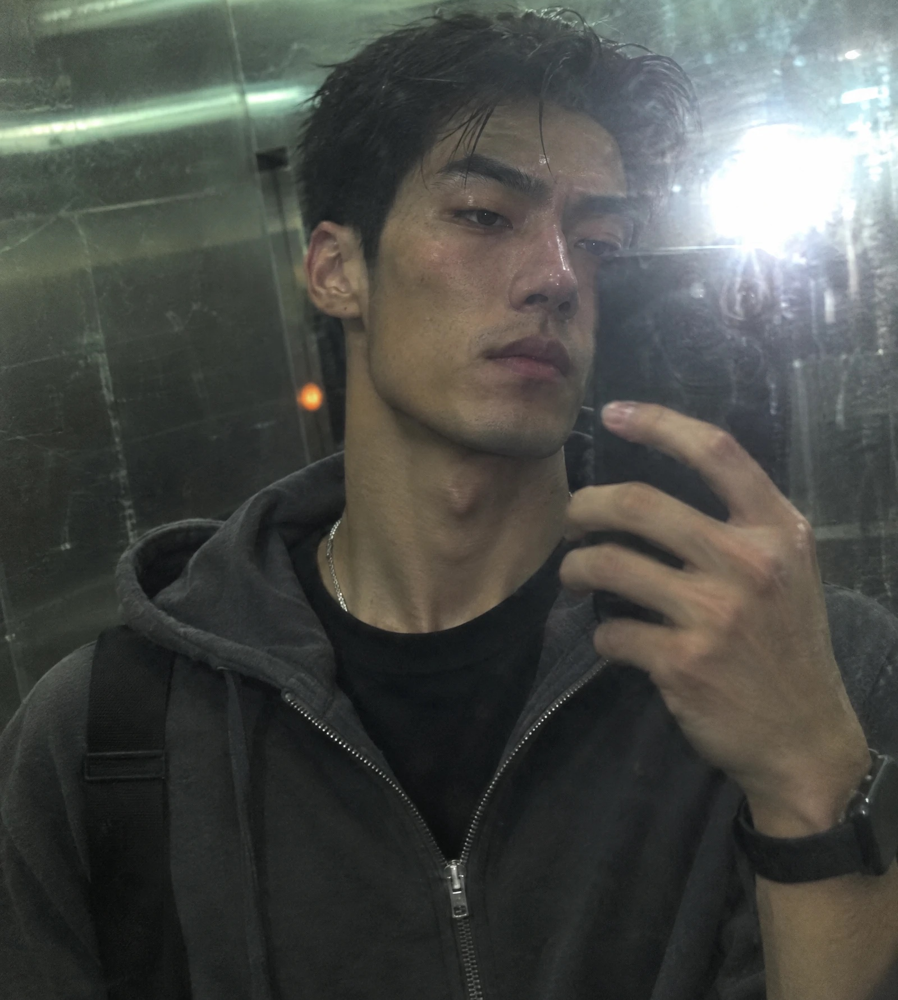

# 相机直闪氛围感照片 · flash-mood-photo

**说一句话，拿到一条"像朋友手机相册里的私密照片"那样的超写实提示词。**

这是一个 [Claude Code](https://claude.com/claude-code) 技能（skill）。你只要说"深夜卧室里的慵懒自拍"这样一句话，它就按九个分区写出一条完整的中文文生图提示词，丢进 Nano Banana Pro 等工具直接出图：离得近、相机直闪、背景暗、人在看你、带几处会反光的小细节——不是图库照片，也不是商业精修大片。

> **English summary:** One line in, a moody photoreal "flash snapshot" prompt out. Describe a moment (e.g. "lazy late-night selfie in the bedroom") and this Claude Code skill writes a complete Chinese text-to-image prompt in nine blocks — person, styling, moment, pose, setting, light, camera, texture, negative prompt — that reads like a real phone or point-and-shoot flash photo: close, imperfect device light, eye contact, a few catch-light details. No reference image, no follow-up questions.

## 出图效果

<table>
<tr>
<td></td>
<td></td>
<td></td>
</tr>
<tr>
<td>"深夜卧室里的慵懒自拍"</td>
<td>"咖啡店窗边看书的女生"</td>
<td>"凌晨健身完，在电梯里对镜自拍的男人"</td>
</tr>
</table>

三条完整提示词都在 [references/examples.md](references/examples.md)。

## 一句话 → 提示词

**① 你说的话**

```
咖啡店窗边看书的女生
```

**② 技能写出的提示词**（9:16）

```
【人物】一位 24 岁的成年东亚女性。脸是偏短的小鹅蛋形，骨相柔和，下巴小巧但不尖；脸颊有一点肉，不显胖；鼻梁细而直，鼻头小圆，带一点自然的粉；内双杏眼，深棕色瞳仁，卧蚕明显，眼神有点困。皮肤白里透暖，看得见毛孔，肤色深浅不完全均匀，两颊浅浅一层粉，眼下有淡淡阴影。嘴唇丰润，保持原生厚度。
【造型】深棕色及肩发，用一只玳瑁色抓夹松松地夹在脑后，夹不住的十几缕散下来，斜着落过额头、一侧眼角和脸颊，有几根停在嘴角边，发丝之间还看得清眼睛；头顶被压得有点塌，头发是真发的毛躁和分叉。淡妆，眼尾扫一笔浅棕，唇上是奶茶玫瑰色的水光唇釉。指甲中等长度、圆杏仁形，半透明奶白底，每个指尖一颗银色小钻。身上是灰调燕麦色的粗针织开衫（无任何标志），一边滑到肩头下面，露出里面白色细吊带的带子和一小片锁骨；袖子过长，盖住半个手背，肘弯压出褶。
【瞬间】傍晚看书看到犯困，朋友突然叫了她一声，她刚抬起眼。眼皮还半垂着，视线直接落在镜头上，有点被打扰的懵，嘴唇放松、微微嘟着，没有在摆表情。
【姿态】整个人趴在小木桌上往镜头这边凑，下巴垫在叠起来的左手手背上；右手食指和中指按着摊开的书页边，手指关节自然、数量正确。手边一杯冰拿铁，杯壁挂满水珠。
【环境】傍晚很暗的小咖啡店角落，深棕色木墙，身后只有一盏暖黄小壁灯的模糊光点，别的都沉在暗处。画面里只有这一个人。
【光】手机贴脸直闪，冷白硬光从正前方打在脸、手指和书页上，闪光衰减明显，脸中间最亮、往两边迅速暗下去；鼻尖、唇釉、指尖小钻和杯壁水珠各闪出一点细小的反光，书页白得有点过曝。身后几乎全黑，只剩那一点暖黄壁灯。不使用影棚柔光、补光灯或轮廓光。
【机位】9:16 竖构图，手机后置主摄贴近拍，约 26mm 等效焦段，近景，略微俯拍，带一点广角透视；脸占画面一大半，开衫袖口、书页和杯子被画面边缘切掉一部分。取景有点歪、有点挤，像随手按下快门；焦点在眼睛和唇釉上，背景轻轻虚掉。
【质感】超写实真人摄影，RAW 原片质感，手机闪光直出，轻微数字噪点和颗粒；冷白、燕麦、深棕黑几种颜色，冷暖对比、低饱和。无后期精修，无磨皮美颜。发丝、手指骨节、皮肤纹理和粗针织的纹路都是真的。慵懒、亲密、生活里的一刻。
【负面提示词】动漫，插画，CGI，3D渲染，磨皮，塑料质感皮肤，过度美白，美颜滤镜，夸张大眼，五官畸形，手部畸形，多指，缺指，手指融合，指甲数量错误，发丝粘连成块，假发感，过度锐化，HDR，文字，Logo，水印，边框，拼接画面，多余人物，影棚布光，商业精修感，图库照片感，咧嘴大笑，书页上可读的文字，杯子上的标志。
```

默认补齐：9:16，手机直闪，24 岁东亚女性，趴桌抬眼看镜头，杯壁水珠做反光细节。

## 两种用法

| 模式 | 你给什么 | 得到什么 |
|---|---|---|
| **一句话模式**（默认） | 一句话，比如"深夜卧室里的慵懒自拍" | 原创面孔的完整提示词，直接文生图 |
| **参考照片锁脸模式** | 一张人像照片 + 一句话，比如"用这张脸，换成凌晨坐出租车回家" | 提示词开头多一个【参考】分区，**只锁五官**，发型、服装、首饰、表情、动作、场景、光线全部重新写；把照片和提示词一起传给支持参考图的出图工具 |

锁脸模式的几个要点（详见 `SKILL.md`）：
- 文字里不再重新描述五官，只写"与参考照片一致"，免得文字和照片打架。
- 为了像：脸至少露出四分之三，表情别大到挤变五官，光线里写"肤色和参考照片一致"。
- 负面提示词开头固定"不像参考人物、五官变形、换脸痕迹"，并把照片里的旧造型列进去，防止被带进新图。

## 为什么有氛围感：八件套

| # | 要做到 | 不要 |
|---|---|---|
| 1 | 一个私密、具体的时刻（深夜、刚下班、微醺、刚睡醒） | 天台远眺、咖啡店看书这类图库套路 |
| 2 | 有瑕疵的设备光：手机直闪、傻瓜机直闪、屏幕光、电梯顶灯 | 黄金时刻、窗边柔光、影棚光 |
| 3 | 贴近：只拍到胸口以上，脸占画面三分之一以上 | 中景、半身 |
| 4 | 和镜头有关系：自拍、看镜头、手挡脸，表情没设防 | 被旁观的侧脸、模特式自信表情 |
| 5 | 2–3 个会反光的小细节：唇釉、美甲钻、银链、杯壁水珠 | 细节平均分配 |
| 6 | 不经意的凌乱：碎发落到脸上、领口滑下来、衣服压皱 | 整整齐齐 |
| 7 | 光的层次：闪光之外，背景有一个带颜色的环境光点 | 只有闪光、身后一面平灰墙 |
| 8 | 一点动态：慢门拖影、风吹、笑意没收、手抖 | 证件照式定格 |

`SKILL.md` 里还有实测踩坑总结出的规则：瑕疵是点缀、颜值是底线；"汗、油、湿"会被模型放大；男女的瞬间和姿态分两套（女性柔、近、慵懒，男性稳、松、带点痞）；以及一张翻车对策表。

## 安装

```bash
git clone https://github.com/likunru-oss/flash-mood-photo.git ~/.claude/skills/flash-mood-photo
```

重新打开 Claude Code 后自动生效。

## 使用

直接用中文说一句话就会触发，例如：

- "相机直闪氛围感照片：深夜卧室里的慵懒自拍"
- "凌晨健身完在电梯里对镜自拍的男人"
- "帮我写一条出图提示词：聚会散场后在天台吹风的男生"

不满意哪一项，下一句直接说"换成傻瓜机直闪""改成男生""比例 4:5"。

## 文件结构

```
flash-mood-photo/
├── SKILL.md                 # 八件套、输出格式、九个分区怎么写、硬规则、验收、翻车对策
├── references/
│   ├── examples.md          # 3 条实测样板 + 1 条锁脸模式写法示例
│   └── presets.md           # 7 种设备光预设 + 不要默认用的图库光 + 焦段速查
└── images/                  # README 里的出图效果
```

## 注意事项

- 人物都是 AI 原创面孔，提示词里不写任何真实人名，也不往某个明星身上靠；画面默认不出现任何品牌标志、可读文字和水印。
- 人物一律写成年，露肤只到肩颈锁骨，姿态非性暗示。请不要用来生成未成年人形象或色情内容。
- 生成的照片看起来像真人随手拍，请不要用来冒充真实的人、注册虚假账号、伪造证据或做任何欺诈；公开发布时建议标注"AI 生成"。
- 出图工具自带的平台水印请按该工具的规则处理。

### 参考照片锁脸模式的风险规避

- **只用你本人的照片，或照片里的人明确同意的照片。** 不要上传明星、网红、公众人物或陌生人的照片来锁脸；技能遇到这类情况会改成"只参考风格、原创面孔"的写法。
- **不锁未成年人的脸。** 照片里的人看起来可能未成年时，技能不会写锁脸版本。
- **不得用于**冒充本人、注册虚假账号、伪造证据、诈骗、换脸恶搞，或任何色情、性暗示内容。
- 用他人肖像生成并公开发布，可能涉及肖像权、名誉权和各平台的 AI 内容规定；公开发布请标注"AI 生成"，商用前请取得本人书面授权。
- 生成效果会随模型版本变化，提示词里写的是"让模型更容易做对"的写法，不保证一次成功；不满意时看 `SKILL.md` 里的翻车对策表。

## 关于样板

`references/examples.md` 和 `images/` 里的人物、场景都是虚构的，图片全部为 AI 生成，只用来展示写法和效果。

## 更新记录

### 2026-11-18
- 新增**参考照片锁脸模式**：上传人像照片，只锁五官，造型、动作、表情、场景、光线全部重写；附带风险检查和"不像时怎么调"。
- 最后一个分区定名为【负面提示词】，改成行业通用的逗号分隔写法；光、机位、质感三个分区使用通用摄影术语。
- 新增第三条实测样板（深夜卧室侧躺自拍）和 README 出图效果展示。

### 2026-11-18 · 首发
- 一句话出氛围感直闪照片提示词：九个分区、氛围感八件套、7 种设备光预设、翻车对策。

## 许可证

本仓库的提示词模板、说明文档和示例以 [Apache License 2.0](LICENSE) 发布：可以自由使用、修改和商用，转载或分发时请保留许可证和署名。

用这些提示词在 Nano Banana Pro 等工具里生成的图片，能否商用以各工具自己的服务条款为准。
